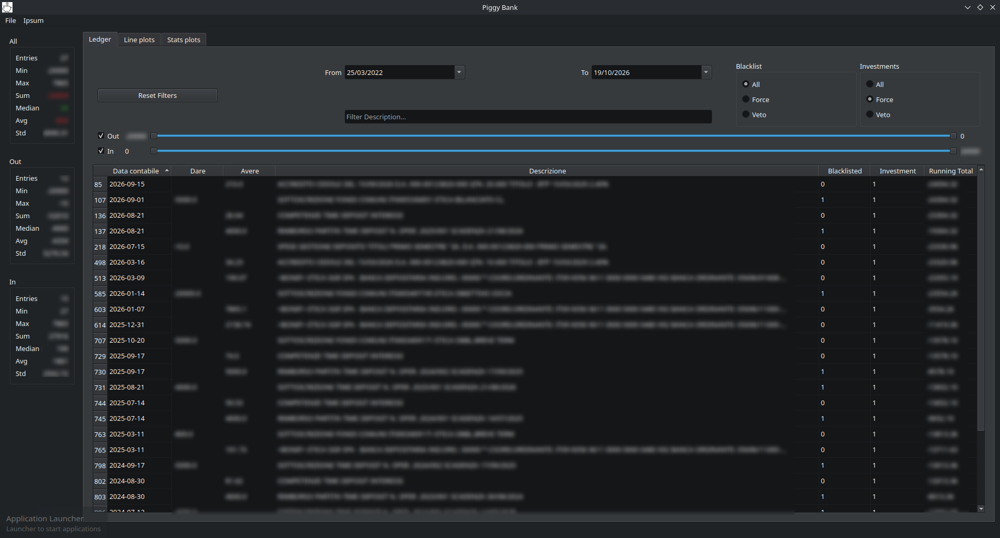

# Piggy Bank

A desktop app to explore your **Banca Etica** current account. Feed it the yearly "Estratto conto Italia" exports from home banking, and it merges them into one ledger you can filter, total and plot.



*The ledger, filtered on investments only. The panel on the left updates its stats with every filter change. Descriptions and amounts are blurred.*

## Features

- **One ledger from many exports.** Drop yearly (or partial) exports in, and overlapping rows are merged away.
- **Live filters.** Filter by date range (with a calendar), description text, incoming/outgoing direction, amount ranges, and class (one checkbox per class).
- **Running total over what you see.** The `Running Total` column and every stat and plot are recomputed over the visible rows only. "How much did investments yield?" is just a few clicks on the class filter.
- **Stats panel.** Count, min, max, sum, median, mean and std for all, outgoing and incoming movements. Sum, median and mean of *All* are green when ≥ 0 and red when negative.
- **Interactive plots** (Plotly):
  - *Line plots*: running total with a linear trend line, and weekly/monthly/yearly balance candlesticks.
  - *Stats plots*: amount histograms; totals by day of week, day of month or month of year; expense and income box plots.
- **Classes.** Every movement gets a class from your own rules (`custom-classes.csv`), e.g. `investment` or `loan`. The rest is `todo`, for now.
- **File menu** to import new exports and class rules, and to export the merged ledger.

## Quick start

You need Python ≥ 3.10 (≥ 3.11 for `./driver.sh --update-venv`) and `bash` (the helper script is a bash script; developed on Linux).

```bash
git clone https://github.com/pbertoni89/piggy-bank.git
cd piggy-bank
./driver.sh --update-venv      # creates .venv and installs everything (editable, see below)
./driver.sh --build-gui        # compiles the UI
./driver.sh --run-gui          # launches the app
```

Then load your data with **File → Import data** and pick a `.xls` export. Alternatively, copy the exports into `data/etica/` before launching.

Install with `-e` (editable). The data folder is located relative to the source tree, so a regular install wouldn't find it.

Plots are rendered by QtWebEngine (included in `PySide6`) and load `plotly.js` from a CDN, so they need network access. Everything else works offline.

Press **Ctrl+C** in the terminal to quit cleanly (exit code 130).

## How filtering works

Every movement has a **Class**, shown as a table column (see [Custom classes](#custom-classes)). The filter panel has one checkbox per class, labelled with its number of movements. All of them start checked; uncheck a class to hide its movements.

Classes combine with AND with the other filters. For example, unchecking `investment` gives your everyday income and spending, without money moved into investments. **Reset Filters** restores everything to its startup state, all classes checked included.

## Your data

Everything lives in `data/etica/`. This folder is gitignored, so your statements never end up in a commit.

| File | Purpose |
|------|---------|
| `*.xls` | Raw exports from home banking. On load they are converted to `*.csv` and **the `.xls` is deleted**, so keep the originals elsewhere. |
| `*.csv` | Statements in `Data contabile,Dare,Avere,Descrizione` format, Banca Etica's own Italian columns. All of them are merged, and from there on the columns are `Date,Out,In,Description`. |
| `custom-classes.csv` | Optional. Rules giving movements a class (see [Custom classes](#custom-classes)). |
| `blacklist.csv` | Archive only, superseded by `custom-classes.csv`. Never read. |
| `merged.csv` | Output only: the merged, sorted ledger (`Date,Out,In,Description`), rewritten on every load. It has no classes. |

Files with any other extension (e.g. `*.csv.bk`) are ignored, which is handy for parking old exports.

The **File** menu manages the folder for you:

- **Import data**: copies a `.xls` export in, converts it and refreshes everything. If a statement with that name already exists (e.g. a newer export of the current year), you're asked before it gets replaced.
- **Import custom classes**: replaces `custom-classes.csv` with the chosen `.csv` and refreshes everything.
- **Export data**: saves a copy of `merged.csv` wherever you like.

If an import breaks loading (an unreadable file, or a rules file without the right header), it is rolled back and the previous data stays as it was.

### Custom classes

`custom-classes.csv` is a list of rules, with the ledger columns plus `Class`:

```csv
Date,Out,In,Description,Class
# Lent to a friend
2026-04-14,-1000,,*,loan
*,*,*,RIMBORSO PARTITA TIME DEPOSIT,investment
*,*,*,SOTTOSCRIZIONE TIME DEPOSIT,investment
```

A rule matches a movement when every field matches:

| Field | `*` | blank | anything else |
|-------|-----|-------|---------------|
| `Date` | any date | invalid | a `YYYY-MM-DD` date |
| `Out`, `In` | any amount | the movement's one must be blank too | that amount, to the cent |
| `Description` | anything | anything | contained in the description, in any letter case |
| `Class` | | invalid | the class name |

- Every distinct `Class` text is a class, typos included: `loans` is not `loan`.
- Rules apply in file order, each one to every movement. The first rule that matches a movement classifies it for good: a later rule giving it a *different* class logs an error and changes nothing.
- Movements no rule matches are `todo`.
- Descriptions are matched after cleanup, i.e. as shown in the ledger (e.g. `<BONIF>`).
- Lines starting with `#` and blank lines are ignored. A malformed line (wrong number of fields, bad date or amount, no class) is logged and skipped. A wrong header makes loading fail.

Classes are recomputed from `merged.csv` and the rules on every load, so after editing the file just restart (or import it).

### Known limitations

- **Identical movements collapse.** Exports can overlap (e.g. a full-year file and a partial one), so exact duplicate rows are removed after merging. Bank exports carry no transaction ID, so two genuinely distinct but identical movements (same date, amount and description, e.g. two SEPA fees on the same day) become one. A warning is logged for every duplicate found.
- **Banca Etica only.** The parser expects its export format and Italian column names.

## Development

`driver.sh` wraps the common tasks (it activates `.venv` itself). `./driver.sh -h` lists them, and `source driver.sh` defines the `pb_*` functions so you can call them one by one.

```bash
./driver.sh --update-venv                      # create/update .venv from pyproject.toml (all extras)
./driver.sh --build-gui                        # compile piggy_bank/ui/*.ui into *_rc.py
./driver.sh --run-gui                          # launch the app (doesn't build the UI)
./driver.sh --build-run-tests                  # build the UI and run the test suite
./driver.sh --build-run-tests -k classes -v    # extra arguments are passed to pytest
./driver.sh --run-designer                     # open the .ui files in Qt Designer
./driver.sh --deprecated-headless              # headless summary (deprecated, see below)
```

Once installed, the app can also be launched as `piggy-bank`.

**UI files.** Layouts are Qt Designer `.ui` files in `piggy_bank/ui/`. The `*_rc.py` modules are generated from them (and gitignored), so never edit those by hand. If you edit a `.ui` file outside Designer while Designer has it open, saving from Designer overwrites your change.

**Tests.** All tests run headless (`QT_QPA_PLATFORM=offscreen`), including the main window. They never touch `data/`: each test works on its own temporary folder.

**Project layout**

```
piggy_bank/
  etica.py         data pipeline and computations (no Qt): load_data, classes, OLS, candlesticks
  main_window.py   main window, ledger filtering, plots, File menu
  filter_tools.py  the filter panel
  aggr_stats.py    the stats boxes
  qw_misc.py       Plotly-in-Qt widget, Ctrl+C handling, small helpers
  ui/              Qt Designer layouts
  driver.py        headless summary (deprecated)
  etica.ipynb      Jupyter notebook (deprecated)
tests/
```

**Headless script and notebook.** These are deprecated but kept working. `./driver.sh --deprecated-headless` and `piggy_bank/etica.ipynb` use the same classes as the app. They compare a few "views" (`etica.DEFAULT_VIEWS`), each one the tuple of classes it leaves out, like unchecking them in the app. For the notebook, open it in JupyterLab (`--update-venv` installs the `notebook` extra too, or use `./driver.sh --docker-jupyter`).

## License

GPL-3.0, see [LICENSE](LICENSE).
