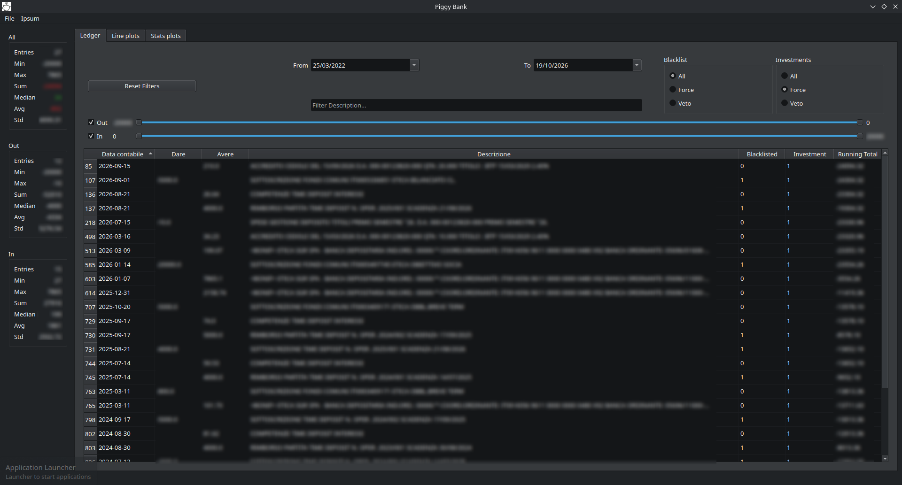

# Piggy Bank

A desktop app to explore your **Banca Etica** current account. Feed it the yearly "Estratto conto Italia" exports from home banking, and it merges them into one ledger you can filter, total and plot.



*The ledger, filtered on investments only. The panel on the left updates its stats with every filter change. Descriptions and amounts are blurred.*

## Features

- **One ledger from many exports.** Drop yearly (or partial) exports in, and overlapping rows are merged away.
- **Live filters.** Filter by date range (with a calendar), description text, incoming/outgoing direction, amount ranges, and two flags: Blacklisted and Investment.
- **Running total over what you see.** The `Running Total` column and every stat and plot are recomputed over the visible rows only. "How much did investments yield?" is just one click on a filter.
- **Stats panel.** Count, min, max, sum, median, mean and std for all, outgoing and incoming movements. Sum, median and mean of *All* are green when ≥ 0 and red when negative.
- **Interactive plots** (Plotly):
  - *Line plots*: running total with a linear trend line, and weekly/monthly/yearly balance candlesticks.
  - *Stats plots*: amount histograms; totals by day of week, day of month or month of year; expense and income box plots.
- **File menu** to import new exports and blacklists, and to export the merged ledger.

## Quick start

You need Python ≥ 3.10 and `bash` (the helper script is a bash script; developed on Linux).

```bash
git clone https://github.com/pbertoni89/piggy-bank.git
cd piggy-bank
python -m venv .venv
source .venv/bin/activate
pip install -e '.[dev]'        # editable install is required, see below
./driver.sh -r                 # builds the UI and launches the app
```

Then load your data with **File → Import data** and pick a `.xls` export. Alternatively, copy the exports into `data/etica/` before launching.

Install with `-e` (editable). The data folder is located relative to the source tree, so a regular install wouldn't find it.

Plots are rendered by QtWebEngine (included in `PySide6`) and load `plotly.js` from a CDN, so they need network access. Everything else works offline.

Press **Ctrl+C** in the terminal to quit cleanly (exit code 130).

## How filtering works

Every movement carries two independent 0/1 flags, shown as table columns:

| Flag | Set when |
|------|----------|
| **Blacklisted** | The movement matches an entry of your `blacklist.csv` (see [Blacklist](#blacklist)). |
| **Investment** | Its description contains `FONDI`, `PROVENTI`, `CEDOLE` or `DEPOSIT`, in any letter case. |

Each flag has its own radio group, and both work the same way:

| Mode | Shows |
|------|-------|
| **All** | Every movement, the flag is ignored |
| **Force** | Only flagged movements |
| **Veto** | Only movements that are *not* flagged |

The two groups combine with AND, along with the other filters. For example, Blacklist *Veto* plus Investments *Veto* gives your everyday income and spending, without one-off transfers or money moved into investments. **Reset Filters** restores everything to its startup state.

## Your data

Everything lives in `data/etica/`. This folder is gitignored, so your statements never end up in a commit.

| File | Purpose |
|------|---------|
| `*.xls` | Raw exports from home banking. On load they are converted to `*.csv` and **the `.xls` is deleted**, so keep the originals elsewhere. |
| `*.csv` | Statements in `Data contabile,Dare,Avere,Descrizione` format (Banca Etica's columns: date, out, in, description). All of them are merged. |
| `blacklist.csv` | Optional. Movements to flag as Blacklisted. |
| `merged.csv` | Output only: the merged, sorted ledger, rewritten on every load. |

Files with any other extension (e.g. `*.csv.bk`) are ignored, which is handy for parking old exports.

The **File** menu manages the folder for you:

- **Import data**: copies a `.xls` export in, converts it and refreshes everything. If a statement with that name already exists (e.g. a newer export of the current year), you're asked before it gets replaced.
- **Import blacklist**: replaces `blacklist.csv` with the chosen `.csv` and refreshes everything.
- **Export data**: saves a copy of `merged.csv` wherever you like.

If an import breaks loading (an unreadable file, or a blacklist entry matching more than one movement), it is rolled back and the previous data stays as it was.

### Blacklist

`blacklist.csv` uses the same columns as the statements. Each row is one of:

- **Exact entry**: `Data contabile` plus `Dare` and/or `Avere`. It must match exactly one movement, otherwise loading fails. `Descrizione` is free text for your own reference.
- **Wildcard entry**: `Dare` and `Avere` left empty. It flags every movement whose description contains the `Descrizione` text (case-sensitive). The date column is ignored; `*` is a convenient marker.

```csv
Data contabile,Dare,Avere,Descrizione
2026-01-14,-20000,,Versamento fondo
*,,,GIROCONTO
```

### Known limitations

- **Identical movements collapse.** Exports can overlap (e.g. a full-year file and a partial one), so exact duplicate rows are removed after merging. Bank exports carry no transaction ID, so two genuinely distinct but identical movements (same date, amount and description, e.g. two SEPA fees on the same day) become one. A warning is logged for every duplicate found.
- **Banca Etica only.** The parser expects its export format and Italian column names.

## Development

`driver.sh` wraps the common tasks (it activates `.venv` itself):

```bash
./driver.sh -r                  # build the UI and launch the app
./driver.sh -t                  # build the UI and run the test suite
./driver.sh -t -k blacklist -v  # extra arguments are passed to pytest
./driver.sh -b                  # only compile piggy_bank/ui/*.ui into *_rc.py
./driver.sh -d                  # open the .ui files in Qt Designer
./driver.sh -i                  # headless summary (deprecated, see below)
```

Once installed, the app can also be launched as `piggy-bank`.

**UI files.** Layouts are Qt Designer `.ui` files in `piggy_bank/ui/`. The `*_rc.py` modules are generated from them (and gitignored), so never edit those by hand. If you edit a `.ui` file outside Designer while Designer has it open, saving from Designer overwrites your change.

**Tests.** All tests run headless (`QT_QPA_PLATFORM=offscreen`), including the main window. They never touch `data/`: each test works on its own temporary folder.

**Project layout**

```
piggy_bank/
  etica.py         data pipeline and computations (no Qt): load_data, filter modes, OLS, candlesticks
  main_window.py   main window, ledger filtering, plots, File menu
  filter_tools.py  the filter panel
  aggr_stats.py    the stats boxes
  qw_misc.py       Plotly-in-Qt widget, Ctrl+C handling, small helpers
  ui/              Qt Designer layouts
  driver.py        headless summary (deprecated)
  etica.ipynb      Jupyter notebook (deprecated)
tests/
```

**Headless script and notebook.** These are deprecated but kept working. `./driver.sh -i` and `piggy_bank/etica.ipynb` use the same flags and All/Force/Veto modes as the app. They compare a few "views" (`etica.DEFAULT_VIEWS`), e.g. *no blacklisted, no investments* vs *investments only*. For the notebook, `pip install -e '.[notebook]'` and open it in JupyterLab.

## License

GPL-3.0, see [LICENSE](LICENSE).
